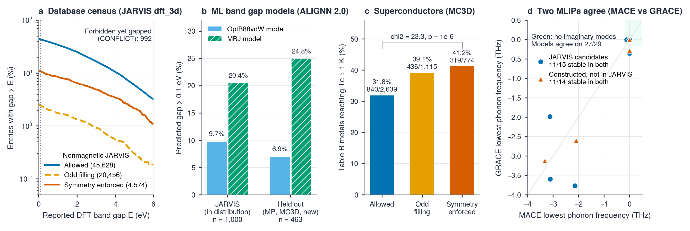

# symlint

**A physics guardrail for AI driven materials discovery.** symlint tells databases, ML models, generative design and AI agents, in milliseconds and without DFT, when a crystal cannot be a band insulator, and turns that into shortlists of semimetals and superconductor candidates.

**Website:** https://asif-iqbal-bhatti.github.io/symlint/



*Submitted to the 4th Open Scientific Intelligence (OSI) Hackathon 2026 by Asif Iqbal Bhatti. Every number in this repository comes from a file in [`results/`](results/).*

## The rule

H. Watanabe, H. C. Po, M. P. Zaletel and A. Vishwanath, [Phys. Rev. Lett. 117, 096404 (2016)](https://arxiv.org/abs/1603.05646), proved that for a nonmagnetic crystal, the space group $G$ and the number of electrons per primitive cell $\nu$ decide whether a band insulator is possible: it requires $\nu \in S_G$, the set of sums of $2 m_w$ over Wyckoff multiplicities per primitive cell. symlint implements this for all 230 space groups (including the four special groups 199, 214, 220 and 230) and gives each structure one verdict:

| Verdict | Meaning |
|---|---|
| `allowed` | $\nu \in S_G$: a band insulator is allowed (not guaranteed) |
| `odd_filling` | $\nu$ odd: cannot be a nonmagnetic band insulator |
| `symmetry_enforced` | $\nu$ even but not in $S_G$: forced gapless by nonsymmorphic symmetry (metal or nodal semimetal) |

Only the structure is needed. Median time is 1.7 ms per crystal ([`results/timing.json`](results/timing.json)).

## Install

Python 3.10 or newer.

```bash
git clone https://github.com/Asif-Iqbal-Bhatti/symlint.git
cd symlint
python -m venv .venv
source .venv/bin/activate          # Windows: .venv\Scripts\activate
pip install -e .                   # core: CLI, Python API, MCP server
pip install -e ".[demo,dev]"       # + marimo notebook and pytest
pytest                             # 16 tests, a few seconds
```

Optional extras, only needed to reproduce the full study:

| Extra | Adds | Used by |
|---|---|---|
| `data` | jarvis-tools, matminer, scipy, requests | database census, Modules C, D, E |
| `ml` | alignn, jarvis-tools | Module A (ALIGNN 2.0 band gap models) |
| `mlip` | torch, mace-torch, tensorpotential, phonopy, seekpath | Step 8 (MACE + GRACE relaxations, phonons; GPU recommended) |

Install with e.g. `pip install -e ".[data]"`. If PyTorch and TensorFlow clash on CUDA versions, install `mlip` in a separate environment.

## Use it

**Command line**

```bash
symlint check tests/data/SrIrO3_Pnma_mp1105160.cif
```

```text
Space group:           Pnma (#62) [symprec=0.001]
Electron count (nu):   556
Allowed set S_G (soc): 8N
Verdict:               symmetry_enforced (can_be_insulator=False)
Tolerance check (0.1): SG #62 (Pnma), nu=556, verdict=symmetry_enforced, sensitive=False
```

`symlint check` accepts any format ASE can read (CIF, POSCAR, ...). `symlint trace <record_id>` prints the provenance chain of any stored result, e.g. `symlint trace CaZnCu_SG62`.

**Python**

```python
from symlint import check_file, classify_filling

res = check_file("tests/data/SrIrO3_Pnma_mp1105160.cif")
print(res["verdict"], res["explanation"])

print(classify_filling(nu=316, sg_number=62))   # 'symmetry_enforced'
```

`check_structure` also takes ASE `Atoms`, pymatgen `Structure` and JARVIS atoms directly.

**AI agents (MCP)**

```bash
symlint mcp                              # MCP server over stdio
claude mcp add symlint -- symlint-mcp    # register with Claude Code
```

Tools: `can_be_insulator`, `robustness_score`, `relax_and_stability`. See [`examples/04_agent_mcp.md`](examples/04_agent_mcp.md).

**Notebook**

```bash
marimo run notebooks/demo.py
```

## Examples

| File | Shows |
|---|---|
| [`examples/01_quickstart.py`](examples/01_quickstart.py) | CIF, ASE and pymatgen inputs; asking the rule directly |
| [`examples/02_screen_folder.py`](examples/02_screen_folder.py) | screen a folder of structures to CSV, with distortion robustness |
| [`examples/03_ml_guardrail.py`](examples/03_ml_guardrail.py) | constrain any band gap model's output |
| [`examples/04_agent_mcp.md`](examples/04_agent_mcp.md) | connect an LLM agent |

## Results

| Study | Result | Status |
|---|---|---|
| Database census, JARVIS `dft_3d` (93,902 entries) | 4,079 nonmagnetic forced gapless candidates; 992 nonmagnetic entries with a gap at a forbidden filling flagged for curation | done |
| ML band gap models, ALIGNN 2.0 | 27.0% of 463 held out forbidden-filling structures get a predicted gap > 0.1 eV | done |
| Superconductors, MC3D (Bercx et al., PRX Energy 2025) | symmetry enforced metals reach Tc > 1 K in 41.2% vs 31.8% of allowed metals (chi squared 23.3) | done |
| Discovery with MACE + GRACE | 11 of 14 constructed Pnma/Cmcm structures, not in JARVIS, stable in both potentials | done (screening level) |
| 2D materials, JARVIS `dft_2d` | 26 candidates, 22 curation flags (stacked slab approximation) | prototype |
| Experimental insulators at forbidden filling | composition matching gives mostly artifacts | prototype |

Details, caveats and all numbers: [`docs/RESULTS.md`](docs/RESULTS.md). Two minute summary: [`docs/PITCH.md`](docs/PITCH.md).

## Reproduce

```bash
python scripts/check_table.py            # S_G for all 230 space groups
python scripts/benchmark_timing.py       # timing
python scripts/audit_jarvis.py           # needs [data]; downloads JARVIS dft_3d
python scripts/run_module_a.py           # needs [ml]
python scripts/run_module_d.py           # needs [data]; MC3D via OPTIMADE
python scripts/run_module_c.py           # needs [data]
python scripts/run_module_e.py           # needs [data]
python scripts/run_phase4_phase5.py      # needs [mlip] and a GPU
python scripts/run_step5b_provenance.py
python scripts/plot_summary_figure.py
```

Downloaded data is cached in `data/` (not tracked).

## Scope

- Nonmagnetic, weakly correlated band theory. Magnetic structures are reported separately, never as violations.
- A forbidden filling means the crystal cannot be a band insulator. It does not prove a topological material; that needs DFT with SOC and irrep analysis.
- MLIP stability and the MLIP hull check are screening estimates; candidates need DFT confirmation.
- Next: the same census on Materials Project and Alexandria, the 1,651 magnetic space groups, 2D layer groups, a proper MLIP hull, an LLM driven design loop.

## Citation

If you use symlint, please cite the theorem it implements:

> H. Watanabe, H. C. Po, M. P. Zaletel, A. Vishwanath, "Filling-Enforced Gaplessness in Band Structures of the 230 Space Groups", Phys. Rev. Lett. 117, 096404 (2016).

## License

MIT, see [`LICENSE`](LICENSE).
