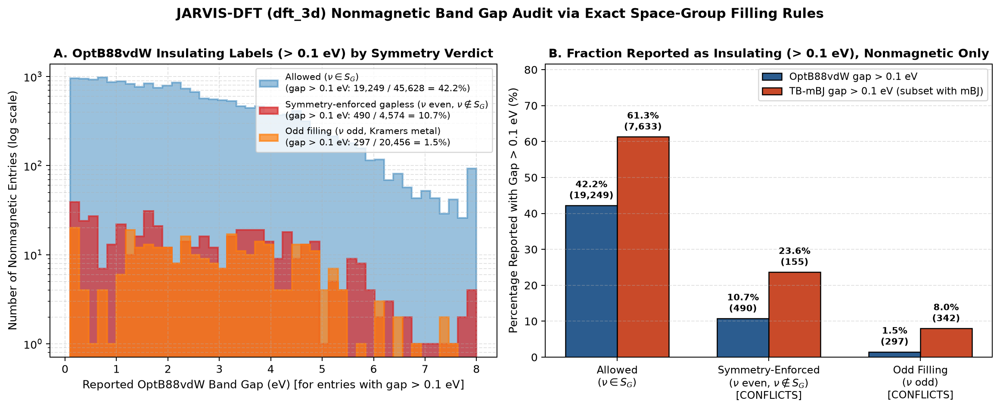
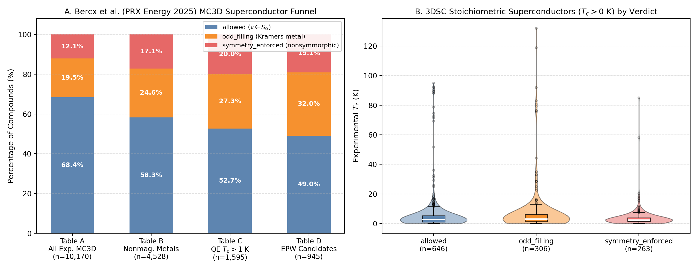

# symlint: a physics guardrail for AI driven materials discovery

**An exact symmetry theorem that tells databases, ML models, generative design and AI agents, in milliseconds and without DFT, when a crystal cannot be an insulator, and turns that into shortlists of semimetals, exotic correlated insulators and superconductor candidates.**

*4th Open Scientific Intelligence (OSI) Hackathon 2026 | Solo entry by Asif Iqbal Bhatti | Team: Forced Crossings*


*Figure: (a) JARVIS census by verdict, (b) ALIGNN 2.0 predictions at forbidden fillings, (c) MC3D metals reaching Tc > 1 K by verdict, (d) MACE vs GRACE lowest phonon frequency. Generated by `scripts/plot_summary_figure.py` from `results/`.*

---

## Executive Summary Table

Every number in this table comes directly from [`results/summary.json`](../results/summary.json) and the corresponding output files in `results/`.

| Module / Step | Question | Headline Result | Output Files | Status |
| :--- | :--- | :--- | :--- | :--- |
| **Step 1: Core Engine** | Can we evaluate the exact 230 space-group filling constraints in milliseconds? | All **230** space groups verified (`226` match $2 m_{\min}\mathbb{N}$; `4` body-centered cubic groups `199, 214, 220, 230` require semigroup/SOC overrides); median **1.7 ms** per structure (19 test structures, range 1.3 to 34 ms). | [`spacegroup_semigroup_table.csv`](../results/spacegroup_semigroup_table.csv), [`timing.json`](../results/timing.json) | **Done** |
| **Step 2: Module B (Database Census)** | Do public DFT databases contain nonmagnetic entries labeled insulating at symmetry-forbidden fillings? | Audited **93,902** entries in JARVIS `dft_3d`: found **992** `CONFLICT` entries (`495` `symmetry_enforced`, `497` `odd_filling`; `991` tolerance-robust), **2,246** `MAGNETIC_EXCEPTION` entries, **4,079** `CANDIDATE` forced-gapless semimetals/metals (`299` with JARVIS `ehull` $\le 0.025\text{ eV/atom}$), and **6,575** `SG_MISMATCH` entries. | [`full_results.parquet`](../results/full_results.parquet), [`conflicts.csv`](../results/conflicts.csv), [`candidates.csv`](../results/candidates.csv), [`gap_distribution_by_verdict.png`](../results/gap_distribution_by_verdict.png) | **Done** |
| **Step 3: Agent Tool & Demo** | Can LLM agents and non-experts call the theorem automatically? | FastMCP server (`can_be_insulator`, `robustness_score`, `relax_and_stability`), CLI (`symlint check`, `symlint trace`), and interactive `marimo` notebook. | [`symlint/mcp_server.py`](../symlint/mcp_server.py), [`notebooks/demo.py`](../notebooks/demo.py) | **Done** |
| **Step 4: Module A (ML Band Gap Audit)** | Do graph neural network band gap predictors (`ALIGNN 2.0`) respect global band-theory filling constraints? | Evaluated official `alignn-2026.8.11` (`optb88vdw_bandgap` and `mbj_bandgap`, $5.0\text{ \AA}$ cutoff) on **1,963** nonmagnetic structures: found **352** violations (`22.7%` violation rate on in-distribution JARVIS forbidden fillings; **`27.0%`** on held-out MP/MC3D/Step 8c structures; **`42.9%`** MBJ violation rate on Step 8c new candidates). Masking forbidden fillings to `0 eV` removes these violations by construction and lifts overall OptB88vdW metal/insulator accuracy from `90.67%` to `91.27%` (1,500 JARVIS structures). | [`moduleA_ml_violations.csv`](../results/moduleA_ml_violations.csv), [`moduleA_all_predictions.csv`](../results/moduleA_all_predictions.csv) | **Done** |
| **Step 5: Module D (Superconductors)** | How do forced-gapless normal states distribute across BCS and experimental superconductors? | **Primary (Bercx et al., PRX Energy 2025 MC3D):** Evaluated **10,170** experimental MC3D structures across the 4-stage funnel (`Table_A` -> `Table_B` `4,528` nonmagnetic metals -> `Table_C` `1,595` with $T_c > 1\text{ K}$ -> `Table_D` `945` EPW candidates). `symmetry_enforced` metals survive from `Table_B` to `Table_C` at **`41.21%`** vs **`31.83%`** for `allowed` metals ($\chi^2 = 23.28$, $p = 1.0 \times 10^{-6}$), yielding **180** nonsymmorphic forced-gapless EPW candidates. **Secondary (3DSC_MP):** **569 / 1,215** (`46.83%`) stoichiometric superconductors have a forced-gapless normal state (**263** `symmetry_enforced`, including $\text{Nb}_3\text{Sn}$, $\text{MoRuP}$, $\text{LiTi}_2\text{O}_4$). | [`moduleD_superconductors.csv`](../results/moduleD_superconductors.csv), [`moduleD_superconductors_funnel.png`](../results/moduleD_superconductors_funnel.png), [`moduleD_nonsymmorphic_candidates.csv`](../results/moduleD_nonsymmorphic_candidates.csv) | **Done** |
| **Step 5b: Trust & Control** | Can every result be traced and every workflow stopped early without AiiDA or a database server? | Self-contained provenance (`symlint/provenance.py`, `results/provenance.jsonl` with **997** records, `record_id` in every CSV, `symlint trace <record_id>`) and staged early-stopping control (`symlint/pipeline.py`). | [`provenance.jsonl`](../results/provenance.jsonl), [`symlint/provenance.py`](../symlint/provenance.py), [`symlint/pipeline.py`](../symlint/pipeline.py) | **Done** |
| **Step 6: Module C (Correlated Insulators)** | Which experimental insulators have a symmetry-forbidden filling and nonmagnetic DFT ground state? | Cross-matched `matbench_expt_gap` (`4,604` compositions, `2,608` matched to lowest-$E_{\text{hull}}$ JARVIS polymorph, `763` with $E_g^{\text{expt}} > 0.1\text{ eV}$): found **67** experimental insulators whose matched JARVIS structure has a forbidden filling (`14` magnetic in DFT; `52` nonmagnetic in DFT, of which only `4` have JARVIS `ehull` $\le 0.1$ eV/atom). Mostly structure-matching artifacts; a hypothesis list, not a result. | [`moduleC_expt_insulators_forbidden.csv`](../results/moduleC_expt_insulators_forbidden.csv), [`moduleC_nonmagnetic_candidates.csv`](../results/moduleC_nonmagnetic_candidates.csv) | **Prototype** |
| **Step 7: Module E (2D & Magnetic Motivation)** | What happens on 2D monolayers (`dft_2d`) and how many magnetic entries motivate 1,651 magnetic space groups? | Audited **1,103** JARVIS `dft_2d` entries (`890` nonmagnetic, `213` magnetic): found **22** `CONFLICT` and **26** `CANDIDATE` monolayers (stacked-slab approximation). Across 3D and 2D, **21,732** magnetic entries (**2,276** `MAGNETIC_EXCEPTION` insulators) motivate extending to the 1,651 magnetic space groups. | [`moduleE_dft2d_results.csv`](../results/moduleE_dft2d_results.csv) | **Done** |
| **Step 8: Dual-MLIP GPU Discovery** | Can we combine exact symmetry screening with **MACE** and **GRACE** on GPU to rank and construct stable forced-gapless crystals? | **8a:** Screened `15` low-$E_{\text{hull}}$ JARVIS `CANDIDATE` entries with `MACE-MPA-0-medium` and `GRACE-2L-OAM` + Phonopy ($>10\text{ \AA}$ supercells); `14 / 15` dual-model agreement, **11 / 15** dynamically stable in both models. **8b:** `4,034 / 4,079` (`98.9%`) `CANDIDATE` entries survive $\ge 1$ maximal subgroup distortion (`52` survive all). **8c:** Constructed `14` new substitutions + `3` PyXtal Wyckoff crystals; `13 / 14` dual-model agreement, **11** Pnma/Cmcm structures not in JARVIS dynamically stable in both MACE and GRACE (screening estimate; hull check is approximate, see Step 8). **8d/8e:** scripted demonstration of the three MCP tools + **5** VASP+SOC+IrRep decks. | [`candidates_ranked.csv`](../results/candidates_ranked.csv), [`candidates_robustness.csv`](../results/candidates_robustness.csv), [`new_candidates.csv`](../results/new_candidates.csv), [`agent_design_log.json`](../results/agent_design_log.json), [`results/dft_handoff/`](../results/dft_handoff/) | **Done** |

---

## 1. Motivation

AI models, high-throughput DFT pipelines, crystal generative models, and autonomous LLM agents now propose and label millions of crystal structures. However, local graph neural networks and generative models do not enforce exact global theorems of quantum condensed matter physics. As a result:

1. **Automated database curation needs exact symmetry checks:** High-throughput DFT workflows can record a positive band gap for a nonmagnetic crystal whose space group and electron count strictly forbid a band insulator (for instance, due to frozen $4f$-core pseudopotentials that alter the effective electron parity, coarse $k$-point meshes that miss symmetry-enforced nodal touchings, or TB-mBJ convergence artifacts). Framing and catching these cases automatically helps curate high-quality reference databases.
2. **Graph neural networks use local cutoffs:** Standard GNN property predictors build graphs within a finite radius (such as $5.0\text{ \AA}$ in ALIGNN 2.0), whereas electron-filling constraints depend globally on the total electron count in the **primitive** unit cell and nonsymmorphic glide/screw symmetries.
3. **Generative discovery wastes compute without pre-filtering:** When searching for forced-gapless semimetals or metals, running DFT or MLIP phonon supercells on structures whose filling already permits a trivial band insulator wastes orders of magnitude in compute.

`symlint` turns the exact filling theorem of Watanabe, Po, Zaletel, and Vishwanath into a millisecond software guardrail, a database curation auditor, an MCP tool for autonomous agents, and a pre-filter for dual-MLIP (`MACE` + `GRACE`) materials discovery.

---

## 2. Physics Rule and Exact Formulation

**Primary Reference:** H. Watanabe, H. C. Po, M. P. Zaletel, and A. Vishwanath, *"Filling-Enforced Gaplessness in Band Structures of the 230 Space Groups"*, Phys. Rev. Lett. **117**, 096404 (2016), [arXiv:1603.05646](https://arxiv.org/abs/1603.05646).

1. **Primitive electron count ($\nu$):** Let $\nu = \sum_{i \in \text{prim}} Z_i$ be the total number of electrons per **primitive** unit cell of a neutral crystal. Using the total atomic number $Z$ is completely independent of pseudopotential core choices because filled atomic core shells always form an allowed atomic-insulator filling in $S_G$.
2. **Atomic insulator semigroup ($S_G^{\text{AI}}$):** For a noninteracting, time-reversal-symmetric (nonmagnetic) crystal in space group $G$ (#1 to #230), an atomic insulator can only be formed at fillings in the numerical semigroup generated by $\{2 m_w\}$, where $m_w$ is the multiplicity of Wyckoff position $w$ counted **per primitive cell** (the conventional Wyckoff multiplicity divided by the lattice centering factor: $P=1$, $A/B/C=2$, $I=2$, $F=4$, $R_{\text{hex}}=3$).
3. **Band insulator set ($S_G^{\text{BI}}$) and the four special cubic groups:**
   - For **226 of the 230 space groups**, $S_G^{\text{BI}} = S_G^{\text{AI}} = 2 m_{\min} \mathbb{N}$, where $m_{\min} = \min_w m_w$ is the smallest primitive Wyckoff multiplicity (`scripts/check_table.py` verifies this across all 230 space groups up to $\nu=200$, saved in [`results/spacegroup_semigroup_table.csv`](../results/spacegroup_semigroup_table.csv)).
   - For **four body-centered cubic space groups** (`SG 199`, `SG 214`, `SG 220`, `SG 230`), the primitive Wyckoff semigroup misses certain small multiples, and spin-orbit coupling (SOC) vs. spinless time-reversal symmetry obeys Table I (middle column $S^{\text{BI}}$) of PRL **117**, 096404 (2016):
     - **`mode="soc"` (default):** `SG 199`: $4\mathbb{N}$; `SG 214`: $4\mathbb{N}$; `SG 220`: $4\mathbb{N} \setminus \{4\}$; `SG 230`: $8\mathbb{N}$.
     - **`mode="spinless"`:** `SG 199`: $4\mathbb{N} \setminus \{4\}$; `SG 214`: $4\mathbb{N} \setminus \{4\}$; `SG 220`: $4\mathbb{N} \setminus \{4, 8, 20\}$; `SG 230`: $8\mathbb{N} \setminus \{8\}$.
   - Note: `symlint` uses the exact band-insulator column $S^{\text{BI}}$ (middle column of Table I), not the looser Bieberbach subgroup bound (`4N` for `SG 73, 106, 110, 133, 135, 142, 206, 228`, where the true band-insulator set is $8\mathbb{N}$).
4. **Verdict classification:**
   - `"odd_filling"`: $\nu$ is odd (trivial Kramers metal; reported separately).
   - `"symmetry_enforced"`: $\nu$ is even but $\nu \notin S_G^{\text{BI}}$ (nonsymmorphic filling-enforced gaplessness; the crystal cannot be a band insulator).
   - `"allowed"`: $\nu \in S_G^{\text{BI}}$ (a band insulator is allowed by filling, though not guaranteed).

---

## 3. Modules and Results

### Module B (Step 2): Database Census on JARVIS `dft_3d` (93,902 Entries)

We audited all **93,902** crystal structures in `jarvis.db.figshare.data("dft_3d")` using `spglib` primitive-cell standardization at `symprec = 1e-3` $\text{\AA}$ and sensitivity re-checking at `symprec = 0.1` $\text{\AA}$ (nonmagnetic threshold $|\mu_{\text{total}}| < 0.05\,\mu_B$/cell; insulating threshold $E_g > 0.1\text{ eV}$).

- **Nonmagnetic breakdown (`70,658` entries):** `45,628` `allowed`, `20,456` `odd_filling`, `4,574` `symmetry_enforced`.
- **`CONFLICT` (`992` entries; [`results/conflicts.csv`](../results/conflicts.csv)):** Nonmagnetic entries with a reported OptB88vdW or TB-mBJ band gap $> 0.1\text{ eV}$ despite a symmetry-forbidden filling (`495` `symmetry_enforced`, `497` `odd_filling`).
  - **`991 / 992` (`99.9%`) are tolerance-robust:** their `symlint` verdict remains forbidden even at `symprec = 0.1` $\text{\AA}$, and `941 / 992` have the exact same space group number in the database metadata.
  - **Curation breakdown (counts from `summary.json`; causes are hypotheses to check, not verified):**
    1. **Lanthanide/actinide entries (`817 / 992`, mostly Nd, Sm, Er, Dy):** zero local moment and a finite gap at a forbidden total filling. A plausible cause is the treatment of partially filled $4f$ shells (f-in-core potentials or missing spin polarization), which changes the effective valence count relative to the total $Z$ used by the theorem. We have not checked the POTCARs used.
    2. **Entries without $f$ elements (`175 / 992`: `21` `symmetry_enforced`, `154` `odd_filling`):** `156` carry a TB-mBJ gap while OptB88vdW gives at most `0.1 eV` (for example bcc $\text{Na}$, `JVASP-14608`, SG 229, $\nu=11$, `mbj_bandgap = 23.50 eV`). The most useful curation targets sit on the JARVIS hull, e.g. `JVASP-176504` $\text{K}_2\text{PtI}_5$ and `JVASP-146141` $\text{Rb}_2\text{PtI}_5$ (SG 63 $Cmcm$, `symmetry_enforced`, OptB88vdW gaps `0.20` and `0.26 eV`, `ehull = 0`), where a gap is forbidden for the stored structure.
  - **Note on `ehull`:** we use the raw JARVIS `ehull` field. Values for some well known stable compounds look high (zincblende GaAs `JVASP-1174`: `0.46 eV/atom`), so filters based on it are indicative only.
- **`MAGNETIC_EXCEPTION` (`2,246` entries):** Magnetic entries ($|\mu| \ge 0.05\,\mu_B$/cell) that open an insulating gap by breaking time-reversal symmetry (`1,035` `symmetry_enforced`, `1,211` `odd_filling`).
- **`CANDIDATE` (`4,079` entries; [`results/candidates.csv`](../results/candidates.csv)):** Nonmagnetic entries with reported gap $\le 0.1\text{ eV}$ and `verdict == "symmetry_enforced"`, including **`299`** with JARVIS `ehull` $\le 0.025\text{ eV/atom}$.
- **`SG_MISMATCH` (`6,575` entries):** Entries where the database space group label differs from `spglib` at `symprec = 1e-3` $\text{\AA}$.



---

### Module A (Step 4): Do ML Models Respect Band Theory? (`ALIGNN 2.0`)

We tested the official `alignn-2026.8.11` ("ALIGNN 2.0") pretrained JARVIS band gap models (`optb88vdw_bandgap` and `mbj_bandgap`, pure-PyTorch radius graph with $r_{\text{cut}} = 5.0\text{ \AA}$ and `max_neighbors = 12`) across **1,963** nonmagnetic structures ([`results/moduleA_ml_violations.csv`](../results/moduleA_ml_violations.csv)):

1. **In-distribution JARVIS nonmagnetic forbidden fillings (`1,000` structures: `500` `symmetry_enforced`, `500` `odd_filling`):**
   - `optb88vdw_bandgap` predicts a forbidden gap $> 0.1\text{ eV}$ on **`9.70%`** (`97 / 1,000`; **`13.20%`** on `symmetry_enforced`, `6.20%` on `odd_filling`).
   - `mbj_bandgap` predicts a forbidden gap $> 0.1\text{ eV}$ on **`20.40%`** (`204 / 1,000`; **`27.80%`** on `symmetry_enforced`, `13.00%` on `odd_filling`).
   - Combined (`any_model_violations`): **`22.70%`** (`227 / 1,000`; **`29.80%`** on `symmetry_enforced`).
2. **Held-out nonmagnetic forbidden fillings NOT in JARVIS (`463` structures: `248` `symmetry_enforced`, `215` `odd_filling` from Materials Project, MC3D, and Step 8c):**
   - `optb88vdw_bandgap` violation rate: **`6.91%`** (`32 / 463`).
   - `mbj_bandgap` violation rate: **`24.84%`** (`115 / 463`; **`27.82%`** on `symmetry_enforced`, `21.40%` on `odd_filling`).
   - Combined held-out violation rate: **`27.00%`** (`125 / 463`; **`29.84%`** on `symmetry_enforced`), with false insulating gaps up to $4.64\text{ eV}$ (for example, `mc3d-34613` $\text{AsPbO}_4$ in `SG 13` $P2/c$, $\nu=294 \notin 4\mathbb{N}$, where DFT is metallic $0.0\text{ eV}$ but ALIGNN 2.0 predicts $1.56\text{ eV}$ OptB88vdW and $4.51\text{ eV}$ MBJ).
   - On our **Step 8c newly constructed forced-gapless candidates (`14` structures)**, `mbj_bandgap` violates the theorem on **`6 / 14` (`42.86%`)** of candidates (up to $1.60\text{ eV}$ on $\text{SrZnAu}$ in `SG 62`).
3. **Hypothesis and guardrail:** ALIGNN builds its graph from local neighborhoods within a $5.0\text{ \AA}$ cutoff, while the filling rule is global (electron count per primitive cell plus nonsymmorphic symmetry). The nonzero held-out violation rate is consistent with this, but we have not proven it is the cause. Applying the `symlint` mask ($\hat{E}_g \leftarrow 0$ whenever `verdict != "allowed"`) removes all violations by construction; the informative numbers are on a 1,500-structure JARVIS evaluation set, where OptB88vdW metal/insulator accuracy rises from `90.67%` to `91.27%` while the gap MAE rises from `0.188` to `0.212 eV` (likely because the mask also zeroes entries that JARVIS labels as gapped at a forbidden filling, i.e. the `CONFLICT` cases).

---

### Module D (Step 5): Superconductors in MC3D (Bercx et al., PRX Energy 2025) and 3DSC

We ran `symlint` on both the primary ab-initio BCS screening dataset of **Bercx et al., *PRX Energy* 4, 033012 (2025)** (`Materials Cloud Archive 10.24435/materialscloud:x2-ap`, structures fetched via the MC3D OPTIMADE API) and the secondary experimental **3DSC_MP** dataset (**Sommer et al., *Sci. Data* 10, 816 (2023)**):

1. **Primary Dataset: Bercx et al. (PRX Energy 2025) MC3D 4-Stage Funnel ([`results/moduleD_superconductors.csv`](../results/moduleD_superconductors.csv)):** structures resolved through OPTIMADE for 10,170 / 10,195 (Table A), 4,528 / 4,533 (B), 1,595 / 1,599 (C) and 945 / 949 (D) entries. The rise in forced-gapless share from Table A to Table B is expected by construction (Table B keeps only metals, and every forbidden filling is a metal); the informative comparison is Table B to Table C.
   - **`Table_A` (`10,170` experimental MC3D compounds):** `6,957` (`68.41%`) `allowed`, `1,979` (`19.46%`) `odd_filling`, `1,234` (`12.13%`) `symmetry_enforced` (`31.59%` forced gapless).
   - **`Table_B` (`4,528` nonmagnetic DFT metals screened):** `2,639` (`58.28%`) `allowed` (metallic by band overlap), `1,115` (`24.62%`) `odd_filling`, `774` (`17.09%`) `symmetry_enforced` (**`41.72%` forced gapless by theorem**).
   - **`Table_C` (`1,595` nonmagnetic metals with QE Allen-Dynes $T_c > 1\text{ K}$):** `840` (`52.66%`) `allowed`, `436` (`27.34%`) `odd_filling`, `319` (`20.00%`) `symmetry_enforced` (**`47.34%` forced gapless**).
   - **`Table_D` (`945` candidates sent to the EPW Migdal-Eliashberg pipeline):** `463` (`48.99%`) `allowed`, `302` (`31.96%`) `odd_filling`, `180` (`19.05%`) `symmetry_enforced` (**`51.01%` forced gapless**; full shortlist of **180** nonsymmorphic EPW candidates saved in [`results/moduleD_mc3d_epw_symmetry_enforced.csv`](../results/moduleD_mc3d_epw_symmetry_enforced.csv)).
   - **Statistical enrichment:** Across the nonmagnetic metals in `Table_B`, **`41.21%`** (`319 / 774`) of `symmetry_enforced` metals achieve $T_c > 1\text{ K}$ in `Table_C`, compared to **`31.83%`** (`840 / 2,639`) of `allowed` metals ($\chi^2 = 23.2822$, $p = 1.0 \times 10^{-6}$). Among the paper's highlighted compounds, `Nb3Sn` (`mc3d-22116`, `SG 223`, $\nu=346$), `V3Si` (`mc3d-73924`, `SG 223`, $\nu=166$), and hexagonal `MoN` (`mc3d-70221`, `SG 194`, $\nu=98$) are `symmetry_enforced`, while half-Heusler `ZrRuSb` (`mc3d-2485`, `SG 216`, $\nu=135$) and `TaRu3C` (`mc3d-79663`, `SG 221`, $\nu=211$) are `odd_filling` Kramers metals.
2. **Secondary Dataset: 3DSC_MP Experimental Superconductors ([`results/moduleD_3dsc_superconductors.csv`](../results/moduleD_3dsc_superconductors.csv)):**
   - Out of `1,215` stoichiometric ordered superconductors ($T_c > 0\text{ K}$), **`569` (`46.83%`)** have a forced-gapless normal state (`306` `odd_filling` = `25.19%`, **`263` `symmetry_enforced` = `21.65%`**; [`results/moduleD_nonsymmorphic_candidates.csv`](../results/moduleD_nonsymmorphic_candidates.csv)).
   - The `263` nonsymmorphic `symmetry_enforced` superconductors include A15 $\text{Nb}_3\text{Sn}$ ($T_c = 16.71\text{ K}$), $\text{MoRuP}$ (`SG 62` $Pnma$, $T_c = 15.50\text{ K}$, $\nu=404 \notin 8\mathbb{N}$), spinel $\text{LiTi}_2\text{O}_4$ (`SG 227` $Fd\bar{3}m$, $T_c = 11.87\text{ K}$, $\nu=158 \notin 4\mathbb{N}$), $\text{LuRuB}_2$ (`SG 62`, $T_c = 10.05\text{ K}$), and $\text{Th}_4\text{H}_{15}$ (`SG 220` $I\bar{4}3d$ override group, $T_c = 8.03\text{ K}$, $\nu=750 \notin 4\mathbb{N}\setminus\{4\}$). `11` of the `263` have a magnetic Materials Project host (e.g. URhGe) and fall outside the nonmagnetic theorem; UCoGe has a nonmagnetic MP host but is an experimentally known ferromagnetic superconductor, so it is out of scope too.
   - *Caveats:* the 3DSC verdict is computed on the matched Materials Project host structure, and the `is_stoichiometric` subset still contains some fractional-occupancy formulas. The analysis is exploratory; for conventional $s$-wave pairing, nonsymmorphic symmetry does not force superconducting gap nodes, and crystal chemistry correlates with space group.



---

### Step 5b: Built-In "Trust and Control" (Zero AiiDA or Database Server Dependency)

Inspired by **P. Kraus et al., *"A bridge between trust and control: computational workflows meet automated battery cycling"*, J. Mater. Chem. A 12, 10773 (2024), DOI: 10.1039/d3ta06889g**, `symlint` implements self-contained provenance (**trust**) and staged early-stopping workflows (**control**) using plain Python and JSONL files:

- **Trust ([`symlint/provenance.py`](../symlint/provenance.py), [`results/provenance.jsonl`](../results/provenance.jsonl)):** Every result carries a deterministic `record_id` in its CSV row backed by a JSON record in `results/provenance.jsonl` storing the canonical structure SHA-256 hash, dataset source, `symlint` version, package versions (`spglib`, `pyxtal`, `numpy`, `mace-torch`, `tensorpotential`, `phonopy`, `alignn`), parameters, stage trace, and output.
- **Control ([`symlint/pipeline.py`](../symlint/pipeline.py)):** Staged execution runs Stage 1 (1 ms symmetry & filling check) -> Stage 2 (1 ms maximal-subgroup robustness) -> Stage 3 (dual-MLIP symmetry-constrained relaxation + symmetry recheck) -> Stage 4 (dual-MLIP supercell phonons). Any candidate that has an `allowed` filling, changes space group upon relaxation, has MACE vs. GRACE stability disagreement, or exhibits imaginary phonon modes beyond tolerance is stopped immediately with its `stop_reason` recorded.

Run `symlint trace <record_id>` on any candidate or conflict:

```text
$ symlint trace CaZnCu_SG62
PROVENANCE & CONTROL TRACE: sym-Step8c_New_Candidates-CaZnCu_SG62-d74b99bf
==============================================================================
Timestamp (UTC)   : 2026-10-21T20:20:09.580173+00:00
Structure SHA-256 : d74b99bf043219bc49eb1cb46512611693710faaeb8e0de4fd0885fa1ad4e64d
Source            : {"dataset": "Step8c_New_Candidates", "id": "CaZnCu_SG62", "prototype_jid": "JVASP-86852", "cif_path": "results/new_candidates/CaZnCu_SG62.cif"}
Code Version      : symlint 0.1.0 (git unknown)
Package Versions  : {"symlint": "0.1.0", "spglib": "2.7.0", "pyxtal": "1.1.5", "numpy": "2.1.3", "ase": "3.29.0", "pymatgen": "2026.9.24", "torch": "2.9.1", "mace-torch": "0.3.16", "tensorpotential": "0.6.2.1", "phonopy": "3.1.0", "alignn": "2026.8.11"}
Parameters        : {"symprec": 0.001, "mode": "soc", "primary_mlip": "MACE-MPA-0-medium", "secondary_mlip": "GRACE-2L-OAM", "imag_threshold_thz": -0.15}
Stopped Early     : False (reason: None)
------------------------------------------------------------------------------
Staged Control Pipeline (4 stages executed):
  Stage 1 [PASS] 1_symmetry_and_filling_check: SG 62 (Pnma), nu=316, rule=8N, verdict=symmetry_enforced
  Stage 2 [PASS] 2_subgroup_robustness_check: Survives 2/7 maximal subgroups (2/7 t-subgroups)
  Stage 3 [PASS] 3_mlip_relaxation_and_symmetry_recheck: SG 62 preserved=True, E_hull(MLIP)=0.0000 eV/atom
  Stage 4 [PASS] 4_dual_mlip_phonons_and_stability: w_min(MACE)=-0.00 THz, w_min(GRACE)=+0.00 THz, both_stable=True, soft_modes=2/4
```

---

### Module C (Step 6): Insulators That Should Not Exist (`matbench_expt_gap`)

By the interacting filling theorem of **Watanabe, Po, Vishwanath, and Zaletel, *PNAS* 112, 14551 (2015)** (Ref. [18] of the 2016 PRL), even a strongly interacting insulator at a forbidden filling must either break a symmetry (such as magnetic ordering or a structural Peierls/charge-ordering distortion) or possess a degenerate / topologically ordered ground state.

Cross-matching `matbench_expt_gap` (`4,604` compositions; `2,608` matched to the lowest-$E_{\text{hull}}$ JARVIS `dft_3d` polymorph of the same reduced formula, an explicit composition-to-structure approximation; `763` experimentally insulating with $E_g^{\text{expt}} > 0.1\text{ eV}$):
- Found **67** experimental insulators whose matched JARVIS structure has a symmetry-forbidden filling ([`results/moduleC_expt_insulators_forbidden.csv`](../results/moduleC_expt_insulators_forbidden.csv)):
  - **14** are magnetic in DFT (`MAGNETIC_EXCEPTION`, expected magnetic insulators).
  - **52** are nonmagnetic in DFT (`24` `symmetry_enforced`, `28` `odd_filling`; `35` contain $f$ elements).
- **Status: prototype.** Because `matbench_expt_gap` gives only compositions, most of these hits are matching artifacts: only `4 / 52` matched structures have JARVIS `ehull` $\le 0.1$ eV/atom, and several matched structures are not the experimental polymorph (e.g. `TlCuCl3` was matched to a hypothetical 5-atom cubic perovskite, while the real crystal is monoclinic; `AgO` was matched to a structure with `ehull = 0.60` eV/atom whose space group changes with tolerance). A proper Module C needs the experimental structure for each composition (e.g. ICSD or MP-ID linked gap data). We therefore do not present any of these as exotic insulator candidates.

---

### Module E (Step 7): 2D Crystals (`dft_2d`) and Magnetic Space Groups Motivation

- **JARVIS `dft_2d` Audit ([`results/moduleE_dft2d_results.csv`](../results/moduleE_dft2d_results.csv)):** Using the 3D periodic stacked-slab cell with vacuum (an explicit decoupled-layer approximation; native 80 layer-group audit is future work), we audited all **1,103** entries in JARVIS `dft_2d` (`890` nonmagnetic, `213` magnetic). We found **22** `CONFLICT` entries (`15` `symmetry_enforced`, `7` `odd_filling`), **30** `MAGNETIC_EXCEPTION` entries, and **26** `CANDIDATE` forced-gapless 2D monolayers (such as `JVASP-60776` $\text{InS}$ and `JVASP-75113` $\text{BiPd}_2\text{O}_4$ in `SG 129` $P4/nmm$, and `JVASP-60315` $\text{NbTe}_5\text{Pd}$ in `SG 26` $Pmc2_1$).
- **Motivation for the 1,651 Magnetic Space Groups:** Across JARVIS `dft_3d` and `dft_2d`, **21,732** magnetic entries (`21,519` in 3D + `213` in 2D), including **2,276** `MAGNETIC_EXCEPTION` insulators (`2,246` in 3D + `30` in 2D), were separated because time-reversal symmetry is broken. Extending `symlint` to the 1,651 magnetic space groups (**H. Watanabe, H. C. Po, and A. Vishwanath, *Sci. Adv.* 4, eaat8685 (2018)**) is a primary direction for future work.

---

### Step 8: GPU Discovery with Two Foundation MLIPs (`MACE` + `GRACE`) and Phonopy

On our laptop GPU (`NVIDIA RTX 2000 Ada Generation Laptop GPU`), we combined `symlint` with **two independent foundation interatomic potentials** requiring agreement: **MACE** (`mace-mpa-0-medium`, PyTorch) and **GRACE** (`GRACE-2L-OAM`, ICAMS `tensorpotential`, TensorFlow/XLA), plus `phonopy` supercell force-constant calculations ($>10\text{ \AA}$ per supercell side):

1. **Step 8a: Ranking Existing JARVIS `CANDIDATE` Entries ([`results/candidates_ranked.csv`](../results/candidates_ranked.csv)):**
   - Relaxed `15` low-$E_{\text{hull}}$ nonsymmorphic `CANDIDATE` crystals under `FixSymmetry` and computed full 3D Brillouin-zone phonon spectra with both **MACE** and **GRACE**.
   - **MACE and GRACE agree on `14 / 15` (`93.3%`) candidates**, confirming **11 / 15** as dynamically stable in **both** potentials (`Cu3Ge` in `SG 194`; `CaGa`, `CaAu`, `SrGa2Cu`, `CaIn2Cu` in `SG 63` $Cmcm$; `CaBr` in `SG 129`; `MgZnCu` in `SG 74`; `BaAu`, `SrCdAu`, `BaAg`, `CaCdAu` in `SG 62` $Pnma$). The single disagreement (`SrCuSn2` in `SG 63`, where MACE gives `-0.00 THz` and GRACE catches a `-0.36 THz` soft mode) highlights the value of dual-MLIP cross-checking.
2. **Step 8b: Exact Subgroup Distortion Robustness & Soft-Mode Isotropy ([`results/candidates_robustness.csv`](../results/candidates_robustness.csv)):**
   - Enumerating all maximal subgroups $G' \subset G$ with exact primitive-cell volume multiplication factors $k = [T_G : T_{G'}]$, **`4,034 / 4,079` (`98.9%`)** `CANDIDATE` entries survive at least one symmetry-lowering distortion, and **`52 / 4,079` (`1.3%`)** survive **all** maximal subgroup distortions. For each Step 8a/8c structure, we also displace along the lowest optical $\Gamma$-point phonon eigenvectors to report how many soft-mode channels preserve `symmetry_enforced` gaplessness.
3. **Step 8c: New Forced-Gapless Candidates by Construction ([`results/new_candidates.csv`](../results/new_candidates.csv), [`results/new_candidates/`](../results/new_candidates/)):**
   - Pre-screened isovalent element substitutions in nonsymmorphic prototypes (`SG 62` $Pnma$, `SG 63` $Cmcm$, `SG 194` $P6_3/mmc$) with `symlint` in milliseconds before running GPU relaxations, an approximate MLIP hull check and dual-MLIP Phonopy supercells.
   - **MACE and GRACE agree on `13 / 14` (`92.9%`) constructed candidates**, yielding **11 dynamically stable forced-gapless structures** in **both** potentials: `CaZnCu`, `CaZnAg`, `CaZnAu`, `CaCdCu`, `CaCdAg`, `SrZnCu`, `SrZnAg`, `SrZnAu`, `SrCdCu`, `SrCdAg` in `SG 62` ($Pnma$, $\nu \equiv 4 \pmod 8$, surviving `2/7` maximal $t$-subgroups `SG 19` and `SG 33`), plus `SrCuGe2` in `SG 63` ($Cmcm$, $\nu=262 \notin 4\mathbb{N}$, surviving `9/14` maximal subgroups). Direct random Wyckoff generation with `pyxtal` ([`results/wyckoff_generated_candidates.csv`](../results/wyckoff_generated_candidates.csv)) independently recovers dynamically stable `CaZnCu` in `SG 62` ($Pnma$).
   - **Novelty and hull caveats:** none of these Pnma/Cmcm structures is in JARVIS `dft_3d`, but CaZnCu (SG 187) and CaZnAg (SG 12) exist there in other space groups, and we have not checked ICSD or Materials Project. The reported `ehull_mlip = 0` is approximate: competing phases are JARVIS entries with `ehull` $\le 0.05$ evaluated as MLIP single points without relaxation, and negative values are clipped to zero. A proper hull (relaxed competitors from MP or Alexandria with the same MLIP) is next.
4. **Step 8d & 8e: Scripted Agent Tool Demonstration & DFT+SOC+IrRep Handoff ([`results/agent_design_log.json`](../results/agent_design_log.json), [`results/dft_handoff/`](../results/dft_handoff/)):**
   - A scripted 3-step trace (no LLM in the loop) shows how an agent would call the MCP tools: `LiZnP` in `SG 129` is rejected at Stage 1 (`allowed`), `NaZnSe` in `SG 129` is `symmetry_enforced` (survives 7 / 10 maximal subgroups) but is dynamically unstable in both MLIPs, and `CaZnCu` in `SG 62` passes all four stages. An LLM-driven loop is next. We also generated **5** ready-to-run VASP + SOC + `IrRep` input decks.

---

## 4. Scope, Honesty Rules, and Limitations

1. **"Forced gapless", not proven topological:** The Watanabe-Po-Zaletel-Vishwanath theorem proves that a crystal *cannot be a band insulator* ($\nu \notin S_G^{\text{BI}}$); it forces the band structure to be gapless (either a nodal semimetal or a metal with a full or compensated Fermi surface). Confirming topological crossings or little-group irreps requires a relativistic DFT band structure and `IrRep` analysis (prepared in `results/dft_handoff/`).
2. **Nonmagnetic, weakly correlated band theory:** The 230 space-group theorem assumes time-reversal symmetry and noninteracting electrons. Magnetic structures are always separated (`MAGNETIC_EXCEPTION`) and never counted as violations.
3. **MLIP stability is a screening estimate:** Foundation potentials (`MACE` and `GRACE`) predict energies, forces, and stresses (never band gaps) and can be slightly soft on phonon branches; top candidates require DFT confirmation.
4. **Four special cubic groups (`199, 214, 220, 230`):** Detecting topological band insulators at fillings where $S_G^{\text{BI}}$ differs from $S_G^{\text{AI}}$ (**H. C. Po, H. Watanabe, M. P. Zaletel, and A. Vishwanath, *Sci. Adv.* 2, e1501782 (2016)**) requires counting the filling of an isolated valence band manifold near $E_F$ from a band structure, not total $Z$ alone.

---

## 5. Related Work and Positioning

The 2016 filling-enforced gaplessness theorem (**Watanabe, Po, Zaletel, and Vishwanath, *Phys. Rev. Lett.* 117, 096404 (2016)**) is the foundational result that led to symmetry indicators (**H. C. Po, A. Vishwanath, and H. Watanabe, *Nat. Commun.* 8, 50 (2017)**) and the 2019 DFT topological materials catalogs:
- **M. G. Vergniory et al., *"A complete catalogue of high-quality topological materials"*, Nature 566, 480 (2019):** Screened 26,938 stoichiometric ICSD materials using DFT band structures and elementary band representations, identifying 3,307 topological insulators and 4,078 topological semimetals.
- **T. Zhang et al., *"Catalogue of topological electronic materials"*, Nature 566, 475 (2019):** Screened 39,519 materials, identifying 8,056 nontrivial topological materials.
- **F. Tang, H. C. Po, A. Vishwanath, and X. Wan, *"Comprehensive search for topological materials using symmetry indicators"*, Nature 566, 486 (2019), DOI: 10.1038/s41586-019-0937-5:** Applied symmetry indicators with GGA and MBJ to highlight 258 topological insulators, 165 topological crystalline insulators, and 489 topological semimetals.

**How `symlint` differs and complements the 2019 catalogs:** The 2019 catalogs require a converged DFT band structure and wavefunctions/irreps for every known crystal. `symlint` requires **only the crystal structure**, runs in **milliseconds** (median 1.7 ms, `results/timing.json`), and works on hypothetical/generated crystals, ML band-gap predictions, and database labels before any DFT calculation is run. As the 2016 PRL Outlook noted, *"the actual prediction of new materials candidates using these insights"* and extensions to magnetic space groups remained open; `symlint` operationalizes the theorem as an automated guardrail for AI workflows.

---

## 6. How to Run

### Installation
```bash
pip install -e .
```

### CLI: Check a CIF File & Trace Provenance
```bash
# Check any crystal structure (CIF, POSCAR, etc.)
symlint check tests/data/SrIrO3_Pnma_mp1105160.cif

# Inspect the full provenance and staged-control chain for any result ID
symlint trace CaZnCu_SG62
symlint trace JVASP-109946
```

### Start the MCP Server for AI Agents
```bash
symlint mcp
```

### Launch the Interactive `marimo` Notebook
```bash
marimo edit notebooks/demo.py
```

### Reproduce All Results and Run Tests
```bash
pytest -v
python scripts/check_table.py
python scripts/benchmark_timing.py
python scripts/audit_jarvis.py
python scripts/run_module_a.py
python scripts/run_module_d.py
python scripts/run_module_c.py
python scripts/run_module_e.py
python scripts/run_phase4_phase5.py   # GPU: MACE + GRACE + phonopy
python scripts/run_step5b_provenance.py
```

---

## 7. Future Work

0. **Cross-database census (Materials Project, Alexandria):** run the same audit on a second and third database. Entries flagged in both JARVIS and MP are stronger curation cases, and MP's `energy_above_hull` and magnetic ordering labels address the two weak points of the JARVIS run (an `ehull` field that looks unreliable for some entries, and magnetism given only as a total moment). `check_structure` already accepts pymatgen structures; only a small database adapter is needed.
1. **1,651 Magnetic Space Groups:** Extend `symlint` to magnetic crystal structures (`MAGNDATA` and spin-polarized DFT databases) using the magnetic filling constraints of **H. Watanabe, H. C. Po, and A. Vishwanath, *Sci. Adv.* 4, eaat8685 (2018)**.
2. **80 Layer Groups for 2D Materials:** Replace the 3D stacked-slab approximation in Module E with native 80 layer-group Wyckoff multiplicities.
3. **Generative Conditional Band-Gap Guardrail:** Embed `symlint` directly into crystal diffusion/flow-matching loops conditioned on non-zero band gaps.
4. **Nonsymmorphic Superconductors:** Combine the 180 `symmetry_enforced` EPW superconductor candidates from Bercx et al. (*PRX Energy* 2025) with odd-parity zone-boundary nodal pairing analysis (**T. Micklitz and M. R. Norman, *Phys. Rev. B* 80, 100506(R) (2009)**).
